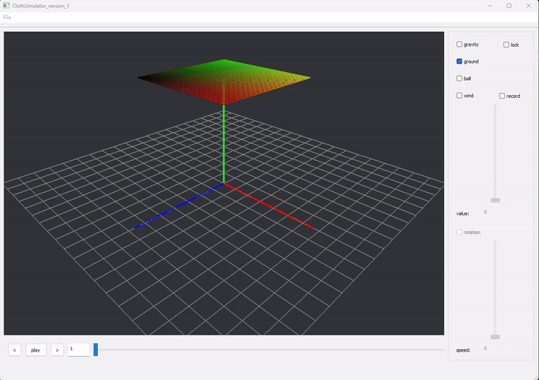
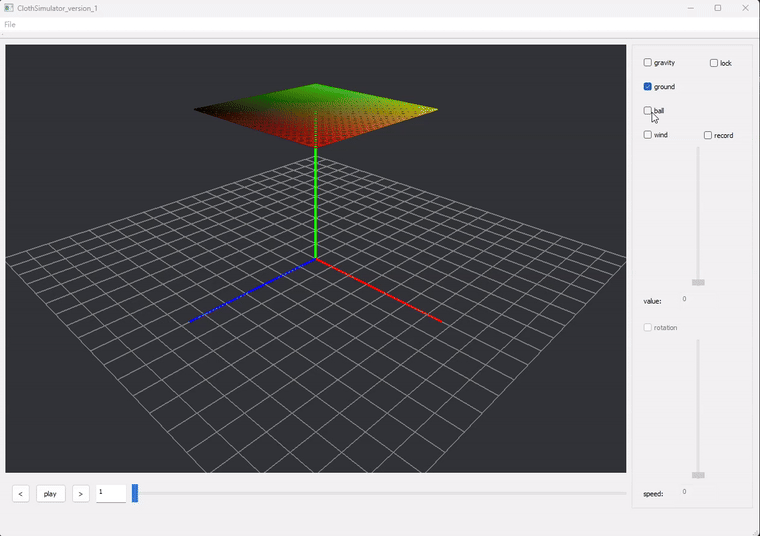

# ClothSimulator

基于 **C++、Qt 5 和 OpenGL** 的交互式布料模拟项目，使用质点—弹簧系统模拟布料变形，支持重力、地面碰撞、球体碰撞、风力和旋转球体。

本项目源于 University of Leeds 的 Animation and Simulation 课程作业。当前版本恢复了 Windows 构建流程，并修复中文路径导入模型时的卡死问题。

## 演示

### 1. 固定两角、下落、地面碰撞与风力

固定布料的两个角，让其余部分在重力作用下下垂；展示与地面的碰撞，随后关闭地面碰撞，并调整外力风力的大小。



### 2. 布料自由下落到球体

布料在重力作用下自由下落，与球形碰撞体接触并产生形变。



### 3. 布料与旋转球体碰撞

布料自由下落到旋转的球形碰撞体上，展示接触后的布料运动。


## 编译与运行

已验证的环境：

- Windows 10/11，构建目标为 **32 位 x86 Release**。
- Visual Studio 2019 C++ 工具集（MSVC 14.29 / v142）。
- Windows SDK 10.0.19041.0。
- **Qt 5.13.0，MSVC 2017 32 位套件**，包含 `qmake`、`moc`、`uic`、`rcc` 和 `windeployqt`。

Qt 与编译器必须匹配架构。当前脚本面向上述 Qt 5 / MSVC x86 配置，尚未验证 Qt 6、MinGW 或其他平台。

安装开发环境后，在项目目录运行：

```bat
build-release.cmd "C:\Qt\5.13.0\msvc2017"
```

也可以设置 `QTDIR` 后直接运行 `build-release.cmd`。脚本自动查找已安装的 Visual Studio C++ 工具集，编译源码，并将 Qt 插件、Qt DLL、微软 C++ 运行库和模型资源复制到 `dist`。

双击以下程序启动：

```text
dist/ClothSimulator_version_1.exe
```

移动或分享运行包时，请复制**整个 `dist` 文件夹**。Qt SDK、DLL 和编译产物不存入本仓库。

## 使用方法

程序启动后，右侧控件灰色是正常状态：需要先导入布料。

1. 点击 **File → Open**。
2. 选择 `testObj/plane10x10.obj`（121 个顶点）；也可以选择 `plane15x15.obj` 或 `plane20x20.obj`。
3. 设置右侧开关，然后点击底部 **play**；再次点击 **pause** 暂停。
4. 暂停后可使用底部时间滑块查看已记录的帧。重新导入模型可重新开始模拟。

球体与地面由程序从 `testObj/environment` 自动加载，不需要通过 File → Open 再导入球体。

| 控件 | 作用 |
| --- | --- |
| `gravity` | 开启或关闭重力 |
| `ground` | 开启或关闭地面显示与碰撞 |
| `ball` | 开启或关闭球体显示与碰撞 |
| `lock` | 固定布料同一条边上的两个角 |
| `wind` | 开启风力，并启用 `value` 滑块 |
| `value` | 风力大小，范围 0–20；默认 0，不产生风力 |
| `rotation` | 开启球体旋转，并启用 `speed` 滑块；先开启 `ball` |
| `speed` | 球体旋转速度，范围 0–720 |
| `record` | 播放时将画面保存为 `output/render_*.bmp` |
| `File → Save` | 将当前布料几何导出为 OBJ |

复现三个案例的设置：

- **固定两角与风力**：导入平面，开启 `lock`、`gravity` 和 `ground`，播放；再关闭 `ground`，开启 `wind` 并调节 `value`。
- **球体碰撞**：导入平面，开启 `gravity`、`ground` 和 `ball`，保持 `lock` 关闭，然后播放。
- **旋转球体碰撞**：在球体碰撞设置上开启 `rotation`，将 `speed` 调为非零值，再播放。

## 项目结构

```text
asset/                       三个 GIF 演示
renderWindow/                OpenGL 渲染、相机交互、OBJ 读取与数学工具
testObj/                     布料网格及球体、地面模型
MainWindow.cpp / .h          文件导入、界面与模拟控制
SimulationEnvironment.*      弹簧连接、外力与模拟环境
SimulationObject.*           顶点状态、积分与碰撞响应
FieldOfForce.*               重力与风力
FrameRecord.*                帧数据记录
ClothSimulator_version_1.ui   Qt 界面
ClothSimulator.pro           qmake 构建入口
build-release.cmd            Windows 编译与运行库打包
```

## 验证与已知限制

已验证 Release 编译、OpenGL 启动、中文绝对路径模型导入、缺失/错误模型拒绝，以及开启重力与球体的布料下落播放。

可运行程序内的诊断模式：

```bat
dist\ClothSimulator_version_1.exe --smoke-test
dist\ClothSimulator_version_1.exe --import-test "D:\models\plane10x10.obj"
```

诊断结束后程序自动退出，并在 EXE 所在目录生成 `startup-check.*` 或 `import-check.*` 报告与截图。导入测试还会播放一个短暂的重力与球体场景。

- 这是课程实验程序，不是通用物理引擎。弹簧连接假设顶点按规则方形网格排列，建议使用自带平面模型。
- OBJ 读取器要求顶点、纹理坐标、法线及 `v/vt/vn` 面索引，不支持所有 OBJ 变体。
- `File → Export` 尚未实现完整导出流程；录制画面请使用 `record`。
- 导入路径已支持 Unicode；`File → Save` 仍沿用旧路径编码，建议导出到纯英文路径。
- 旋转和风力演示 GIF 来自原项目；当前恢复版本尚未对所有参数组合做回归验证。

## 致谢与代码来源

保留源码中的 University of Leeds 课程标注与 Hamish Carr 提供的基础渲染代码署名。演示素材位于 `asset`。本仓库没有新增统一开源许可证；各文件原有署名和许可声明保持有效。
